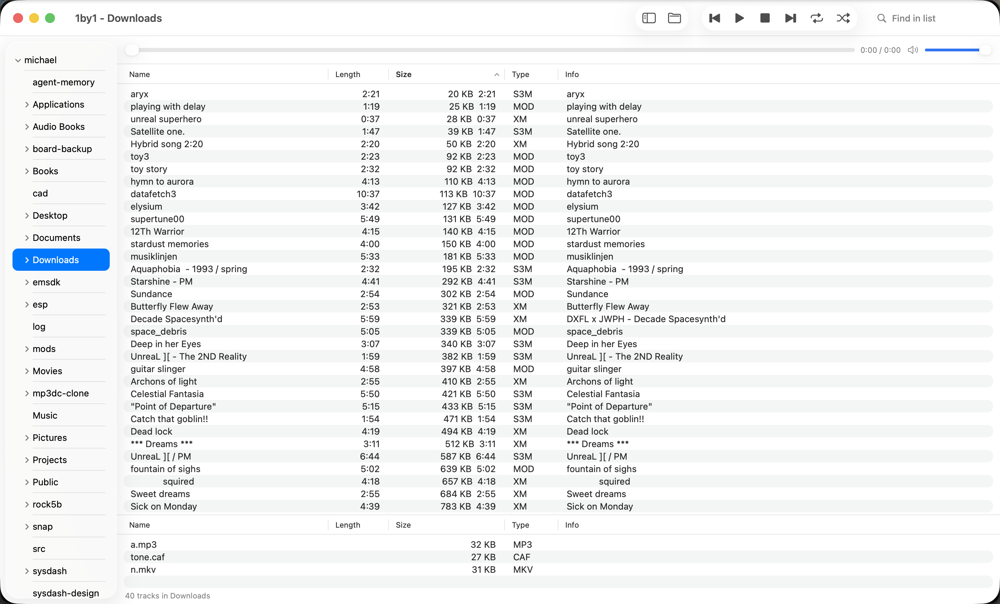

# 1by1

**A folder is the queue.** Pick a folder, and its tracks play in order. Native macOS, no visualizer, no bloat.




1by1 is a directory player for people who keep music in folders. The sidebar shows the folder tree. The list shows the tracks. A playlist collects tracks from anywhere. Playback is gapless. Everything runs natively in Swift and AppKit, with AVFoundation for most formats and small, focused libraries for the rest.

---

## Highlights

- **Folder as queue.** Click a folder, and its tracks become the queue. Next and previous walk the list.
- **Gapless playback.** One AVAudioEngine output. Tracks feed ahead of time, so there is no gap between them.
- **Every format that matters.** MP3, AAC, FLAC, ALAC, WAV, AIFF, CAF, Ogg Vorbis, Opus, Matroska, WebM, and tracker modules.
- **Tracker modules.** MOD, XM, S3M, IT, and friends. Read the title, tracker, structure and song message.
- **Sortable, configurable list.** Sort by any column. Show or hide columns from the header menu. Widths and order are remembered.
- **Playlist that remembers.** Queue, order, and open state survive a relaunch. Drag to reorder.
- **Tag editing.** Read and write tags on every format TagLib supports.
- **Move and trash.** Move tracks to another folder. Create, rename or trash folders. Option-Delete sends tracks to the Trash, after a confirmation.
- **Right-click everywhere.** Context menus on the track list, the playlist, and the folder tree.
- **Compact view.** Just the transport. Press F7.
- **Remote control.** A small HTTP control page on `127.0.0.1:8080`.
- **Small.** About 6 MB. FFmpeg is a decode-only build with no encoders.

---

## Formats

| Decoder | Formats |
| --- | --- |
| AVFoundation | MP1, MP2, MP3, AAC/ADTS, M4A, M4B, ALAC, FLAC, WAV, AIFF, CAF, Ogg Opus |
| libvorbisfile | Ogg Vorbis |
| libopenmpt | MOD, XM, S3M, IT, MTM, MO3, MPTM, 669, FAR, MED, STM, PTM, ULT, OKT, and more |
| FFmpeg (minimal) | Matroska, WebM, MKA, and any file AVFoundation refuses |

Cue sheets expand into virtual tracks. `.m3u` and `.m3u8` files load as lists.

---

## Install and build

You need Xcode Command Line Tools (Swift 6) and Homebrew.

```sh
brew install libopenmpt libvorbis libogg taglib

# Optional but recommended: a minimal FFmpeg (6 MB bundle instead of 38 MB)
FFMPEG_SRC=/path/to/ffmpeg-source ./scripts/build-ffmpeg-min.sh

./scripts/make-app.sh     # release build, dist/OneByOne.app with libraries bundled
open dist/OneByOne.app
```

Without the minimal FFmpeg, `make-app.sh` bundles Homebrew's FFmpeg. The bundle is larger but works.

The app is ad hoc signed. It runs on the machine that built it. Public distribution needs a Developer ID certificate and notarization.

---

## Keys

| Action | Key |
| --- | --- |
| Play or pause | Space |
| Stop | Command-. |
| Rewind or forward 5 s | Left or Right |
| Previous or next folder | Shift-Left or Shift-Right |
| Previous or next track | Control-Left or Control-Right |
| Volume up or down | Control-Up or Control-Down |
| Add selected to playlist | Control-Return |
| Track info | Command-I or Option-Return |
| Move selected to Trash | Option-Delete |
| Go to track | Command-G |
| Find in list | Control-F |
| Find files under the tree | F3 |
| Folder tree | F4 |
| Reload folder | F5 |
| Playlist view | Shift-F5 |
| Compact view | F7 |
| Big title view | Control-B |
| Settings | F6 or Command-, |

---

## Use

- **Open a folder.** File > Open Folder, drop a folder on the window, or click it in the tree.
- **Play.** Double-click a row. Or press Space on a selected row.
- **Queue.** Select rows and press Control-Return. Drag in the playlist to reorder.
- **Sort.** Click a column header. Right-click the header to show or hide columns.
- **Organize.** Right-click a track to move it to another folder. Right-click a folder to create, rename or trash it.
- **Search.** Find in list (Control-F) jumps to the first match. Find Files (F3) searches every folder under the tree.
- **Bookmarks.** Save folders and tracks. Up to 30 entries.
- **Remote.** File > Start HTTP Remote opens a control page on `127.0.0.1:8080`. Paths: `/res /prv /nxt /rew /fwd /vdn /vup /dprv /dnxt /home`.

Settings live in `~/Library/Application Support/1by1/settings.json`. They save on every change. The app imports `~/.config/1by1/settings.toml` from the earlier Rust build on first run.

---

## Layout

```
Sources/OneByOne/
  App/        entry point, delegate, menus, bookmarks
  Model/      player controller, settings, playlist persistence
  Audio/      gapless engine, PCM sources (AVFoundation, Vorbis, OpenMPT, FFmpeg)
  Library/    folder scan, cue and m3u, TagLib tags, module metadata
  Remote/     HTTP remote
  UI/         split view, folder tree, track table, context menus, file operations,
              track info, big title, settings
  Logic.swift repeat, next and previous, shuffle, natural sort, clock
scripts/
  make-app.sh            app bundle with libraries
  build-ffmpeg-min.sh    minimal decode-only FFmpeg into .ffmpeg-min/
```

---

## Self checks

```sh
.build/debug/OneByOne --selftest                 # logic checks
.build/debug/OneByOne --scan <folder>            # what the library sees
.build/debug/OneByOne --smoke <file> [<file>...] # headless gapless playback
.build/debug/OneByOne --import-check             # what the Rust settings import finds
```

---

## Status

Verified on screen: playback, gapless queue, folder tree, sorting, column menu, playlist and its restore, context menus, module info, compact view, tag editing.

Built, not yet tested on screen: move to folder, folder operations, Option-Delete, drag to reorder.

Not yet done: notarized distribution. The app runs on the machine that built it.
